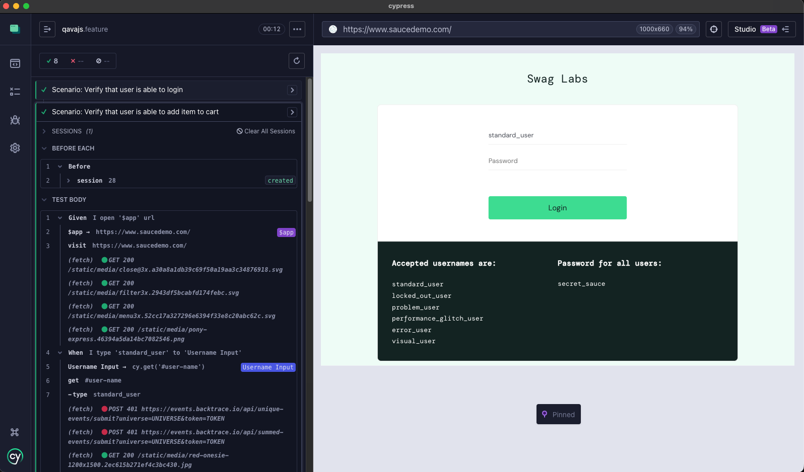

# @qavajs/cypress
qavajs implementation on top of cypress runner



Demo projects:
- https://github.com/qavajs/demo/tree/main/cypress

## Installation
  
```
npm install cypress
```

:::note
`@qavajs/cypress@3` requires Cypress 16 and ESM `cypress.config.js`
:::

```
npm install @qavajs/cypress @qavajs/cypress-runner-adapter @qavajs/memory
```

## Configuration
cypress.config.js
```javascript
import { defineConfig } from 'cypress';
import cucumber from '@qavajs/cypress-runner-adapter/adapter';

export default defineConfig({
    e2e: {
        specPattern: 'cypress/features/**/*.feature', //path to features
        supportFile: 'cypress/support/e2e.js', //path to main support file
        setupNodeEvents(on, config) {
            on('file:preprocessor', cucumber);
        },
    },
});
```
support file
```typescript
import defineQavajs from '@qavajs/cypress/defineQavajs';
import '@qavajs/cypress';

import PageObject from '../page_object'; // path to qavajs page objects
import Memory from '../memory'; // path to qavajs memory

defineQavajs({
    pageObject: new PageObject(),
    memory: new Memory()
});
```

## Page Object
```typescript
import { locator } from '@qavajs/cypress/po';

class Header {
    Logo = locator('.logo');
}

export default class App {
    SearchInput = locator('#search');
    // parameterized selector
    ResultByIndex = locator.template(idx => `.result-item:nth-child(${idx})`);
    // custom cypress query
    ActiveTab = locator.native(({ cy }) => cy.get('.tab').filter('.active'));
    // nested component
    Header = locator('header').as(Header);
}
```

## Tags
Test can be filtered using Cucumber tag expressions provided via environment variable `TAGS`
```
TAGS='@first and @second' npx cypress run
```

## Translation Mode
Gherkin tests can be translated in different modes
- `describe` - default mode. Scenario will be translated as `describe`, each step will be translated as `it`
- `it` - Scenario will be translated as `it`

```bash
MODE=it npx cypress open
```
