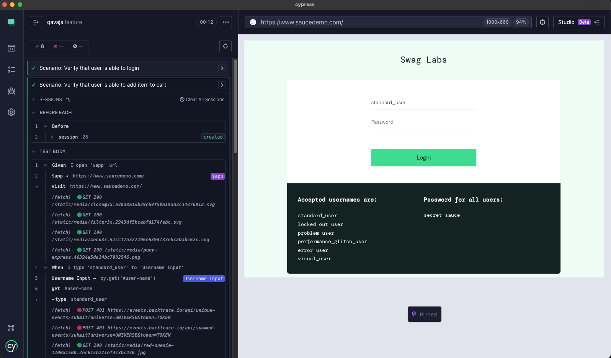

# @qavajs/cypress
qavajs implementation on top of cypress runner



Demo projects:
- https://github.com/qavajs/demo/tree/main/cypress

## Installation
  
```
npm install cypress
```

:::note
`@qavajs/cypress@3` requires Cypress 16 and ESM `cypress.config.js`
:::

```
npm install @qavajs/cypress @qavajs/cypress-runner-adapter @qavajs/memory
```

## Configuration
cypress.config.js
```javascript
import { defineConfig } from 'cypress';
import cucumber from '@qavajs/cypress-runner-adapter/adapter';

export default defineConfig({
    e2e: {
        specPattern: 'cypress/features/**/*.feature', //path to features
        supportFile: 'cypress/support/e2e.js', //path to main support file
        setupNodeEvents(on, config) {
            on('file:preprocessor', cucumber);
        },
    },
});
```
support file
```typescript
import defineQavajs from '@qavajs/cypress/defineQavajs';
import '@qavajs/cypress';

import PageObject from '../page_object'; // path to qavajs page objects
import Memory from '../memory'; // path to qavajs memory

defineQavajs({
    pageObject: new PageObject(),
    memory: new Memory()
});
```

`defineQavajs` must be called in the same bundle (the support file) that imports `@qavajs/cypress`. `memory` is optional; `pageObject` can be an instance or a class.


## Logging

qavajs writes memory reads/writes (`$key →`, `$key ←`), resolved page object elements and HTTP requests to the Cypress command log.
The full value is available in DevTools console after clicking the entry. Use the `log` option to tune it:

```typescript
defineQavajs({
    pageObject: new PageObject(),
    log: {
        memory: true,           // memory reads and writes
        elements: true,         // page object element resolution
        requests: true,         // `I send ... request` step
        maxLength: 200,         // truncate command log messages (0 - no truncation)
        mask: ['password', /token/i, 'authorization'] // replace matching keys and properties with ***
    }
});
```

`log: false` disables all qavajs entries. `mask` patterns are matched against memory keys/expressions and object property names
(e.g. request/response headers and body fields); string patterns match case-insensitive substrings.
`this.log` in custom steps writes to the command log and attaches the message to the test report.

## Page Objects

Page objects define element locators used in step definitions.

```typescript
import { locator } from '@qavajs/cypress/po';

class Header {
    Logo = locator('.logo');
    Nav  = locator('nav');
}

export default class App {
    // Simple CSS/XPath selector
    SearchInput = locator('#search');
    SearchButton = locator('#searchBtn');
    Results = locator('.result-item');

    // Parameterized selector
    ResultByIndex = locator.template(idx => `.result-item:nth-child(${idx})`);

    // Custom Cypress query
    ActiveTab = locator.native(({ cy }) => cy.get('.tab').filter('.active'));

    // Nested component
    Header = locator('header').as(Header);
}
```

Elements are referenced in steps by their property name (e.g. `'Search Input'` or `'Header > Logo'` for nested components).
Spaces in a path are ignored, so `'Search Input'` resolves `SearchInput`; names are case-sensitive.
Template and native locators take an argument in parentheses: `'Result By Index (2)'`, `'Header > Item By Text (Login)'`.

When an alias is not found, the error suggests the closest names and lists the aliases of the component:

```
Alias 'SearchInpt' has not been found in 'App'. Did you mean 'SearchInput'?
Available aliases: SearchInput, SearchButton, Results, ResultByIndex, ActiveTab, Header
```

## Memory

The memory class stores values accessible in steps via the `$key` syntax.

```typescript
export default class Memory {
    baseUrl = 'https://example.com';
    testUser = 'user@example.com';
    // Functions are called on access
    timestamp = () => Date.now();
    uppercase = (str: string) => str.toUpperCase();
}
```

Use `$key` in any step parameter to reference a memory value, `$key()` to call a function, and `$key.property` for nested access.


## Custom Steps

`this` in steps is a `QavajsCypressWorld`. `{value}` parameters are `MemoryValue` objects: resolve them inside Cypress command callbacks, so values saved by previous steps are available in both `describe` and `it` modes.

```typescript
import { When } from '@qavajs/cypress-runner-adapter';
import type { QavajsCypressWorld, MemoryValue } from '@qavajs/cypress';

When('I type {value} slowly into {locator}', function (
    this: QavajsCypressWorld,
    text: MemoryValue,
    locator: Cypress.Chainable<JQuery<HTMLElement>>
) {
    locator.then($el => cy.wrap($el).type(text.value(), { delay: 200 }));
});
```


## Step Definitions

Parameters in quotes (`'...'`) accept memory expressions (`'$key'`, `'$fn()'`, `'$js(...)'`). Single or double quotes can be used.
Steps marked with `:` take a docstring (`"""`) or a data table on the next lines.

### Navigation & Actions

| Step | Description |
|------|-------------|
| `I open '{value}' url` | Navigate to a URL |
| `I refresh page` | Reload current page (alias: `I reload page`) |
| `I reload page` | Reload current page |
| `I go back` | Browser history back |
| `I go forward` | Browser history forward |
| `I click '{locator}'` | Click an element |
| `I force click '{locator}'` | Force-click (bypasses actionability checks) |
| `I double click '{locator}'` | Double-click |
| `I right click '{locator}'` | Right-click |
| `I type '{value}' to '{locator}'` | Type text into an element |
| `I type '{value}' into '{locator}'` | Alias for type |
| `I clear '{locator}'` | Clear an input |
| `I clear '{locator}' and type '{value}'` | Clear an input, then type text |
| `I check '{locator}'` | Check a checkbox or select a radio button |
| `I uncheck '{locator}'` | Uncheck a checkbox |
| `I press '{key}' key` | Press a key or combo (Cypress `type` syntax, e.g. `{enter}`, `{ctrl}c`) |
| `I press '{key}' key {int} times` | Press key N times |
| `I hover over '{locator}'` | Hover over element (dispatches mouse events; CSS `:hover` is not triggered) |
| `I select '{value}' option from '{locator}' dropdown` | Select option by text or value |
| `I select {int} option from '{locator}' dropdown` | Select option by 1-based index; ordinal suffix is optional (`I select 2nd option from 'Country' dropdown`) |
| `I click '{value}' text in '{locator}' collection` | Click the element of collection whose text contains value |
| `I upload '{value}' file to '{locator}'` | Upload a file (path relative to project root) |
| `I scroll to '{locator}'` | Scroll element into view |
| `I scroll by '{value}'` | Scroll page by `x, y` offset |
| `I scroll by '{value}' in '{locator}'` | Scroll within element |

### Alerts & Dialogs

| Step | Description |
|------|-------------|
| `I will accept alert` | Accept confirm dialogs for the rest of the scenario (default) |
| `I will dismiss alert` | Dismiss confirm dialogs for the rest of the scenario |
| `I will type '{value}' to alert` | Answer prompt dialogs with value for the rest of the scenario |

Dialog settings survive navigation and are reset when the next scenario starts.

### Element Validations

| Step | Description |
|------|-------------|
| `I expect '{locator}' {condition}` | Assert element condition (see Conditions) |
| `I expect every element in '{locator}' collection {condition}` | Assert condition of all elements in collection |
| `I expect text of '{locator}' {validation} '{value}'` | Assert element text |
| `I expect value of '{locator}' {validation} '{value}'` | Assert input value |
| `I expect '{attr}' attribute of '{locator}' {validation} '{value}'` | Assert attribute |
| `I expect '{prop}' property of '{locator}' {validation} '{value}'` | Assert property |
| `I expect '{prop}' css property of '{locator}' {validation} '{value}'` | Assert computed CSS property |
| `I expect '{expr}' custom property of '{locator}' {validation} '{value}'` | Assert via JS function (e.g. `$js(e => e.prop('value'))`) |
| `I expect number of elements in '{locator}' collection {validation} '{value}'` | Assert collection size |
| `I expect text of every element in '{locator}' collection {validation} '{value}'` | Assert text of all elements |
| `I expect '{attr}' attribute of every element in '{locator}' collection {validation} '{value}'` | Assert attribute of all elements |
| `I expect '{prop}' property of every element in '{locator}' collection {validation} '{value}'` | Assert property of all elements |
| `I expect '{expr}' custom property of every element in '{locator}' collection {validation} '{value}'` | Assert JS function result of all elements |
| `I expect current url {validation} '{value}'` | Assert current URL |
| `I expect page title {validation} '{value}'` | Assert page title |
| `I expect text of alert {validation} '{value}'` | Assert text of the oldest not yet validated dialog of the scenario (waits for it to appear) |

Element validations retry until `defaultCommandTimeout`.

**Conditions:** `to be visible`, `to be hidden` (alias: `to be invisible`), `to be present`, `to be enabled`, `to be disabled`, `to be in viewport`, `to be clickable`.
Prefix with `not` to negate: `not to be present`.

### Value Validations

| Step | Description |
|------|-------------|
| `I expect '{value}' {validation} '{value}'` | Compare two values, e.g. `I expect '$response.status' to equal '200'` |
| `I expect '{value}' {validation} at least one of '{value}'` | Pass if value satisfies validation with at least one item of array |
| `I expect '{value}' {validation} at least one of:` + table | Same with expected values from a one-column table |
| `I expect '{value}' {validation} all of '{value}'` | Pass if value satisfies validation with every item of array |
| `I expect '{value}' {validation} all of:` + table | Same with expected values from a one-column table |
| `I expect every element in '{value}' array {validation} '{value}'` | Every array item satisfies validation |
| `I expect at least {int} elements in '{value}' array {validation} '{value}'` | At least N array items satisfy validation |
| `I expect '{value}' array {validation}:` + table | Validate array against one-column table, e.g. `to have members` |
| `I expect '{value}' array to be sorted by '{value}'` | Array is sorted by comparator function from memory |

**Validations:** `equal`, `strictly equal`, `deeply equal`, `case insensitive equal`, `contain`, `match`, `above`, `below`, `greater than`, `less than`, `have type`, `have property`, `have members`, `include members`, `satisfy`.
They can be written as `to equal`, `equals`, `to be equal`, `does not contain`, `not to match` etc.

- `equal` uses loose comparison (`'1'` equals `1`), `strictly equal` uses `===`.
- `above`, `below`, `greater than`, `less than` convert numeric strings (e.g. element text `'42'`) to numbers.
- `match` accepts a regular expression string (`'^\d+$'`) or a RegExp from memory (`'$js(/abc/i)'`).

:::note
Soft validations (`to softly equal`), `match schema` and `... to` forms are not supported by `@qavajs/cypress` since 3.1.0.
:::

### Memory Steps

| Step | Description |
|------|-------------|
| `I save text of '{locator}' as '{key}'` | Save element text |
| `I save value of '{locator}' as '{key}'` | Save input value |
| `I save '{attr}' attribute of '{locator}' as '{key}'` | Save attribute value |
| `I save '{prop}' property of '{locator}' as '{key}'` | Save property value |
| `I save '{prop}' css property of '{locator}' as '{key}'` | Save computed CSS property |
| `I save '{expr}' custom property of '{locator}' as '{key}'` | Save JS function result |
| `I save number of elements in '{locator}' collection as '{key}'` | Save collection size |
| `I save text of every element of '{locator}' collection as '{key}'` | Save array of texts |
| `I save '{attr}' attribute of every element of '{locator}' collection as '{key}'` | Save array of attributes |
| `I save '{prop}' property of every element of '{locator}' collection as '{key}'` | Save array of properties |
| `I save '{expr}' custom property of every element of '{locator}' collection as '{key}'` | Save array of JS function results |
| `I save bounding rect of '{locator}' as '{key}'` | Save element bounding rect |
| `I save current url as '{key}'` | Save current URL |
| `I save page title as '{key}'` | Save page title |
| `I save '{value}' to memory as '{key}'` | Store a value |
| `I set '{key}' = '{value}'` | Alias for save to memory |
| `I save json to memory as '{key}':` + docstring | Store a parsed JSON object |
| `I save key-value pairs to memory as '{key}':` + table | Store an object from a two-column table |
| `I save multiline string to memory as '{key}':` + docstring | Store a multiline string |

### Mouse Interactions

| Step | Description |
|------|-------------|
| `I press {mouseButton} mouse button on '{value}'` | Press mouse button at `x, y` |
| `I release {mouseButton} mouse button on '{value}'` | Release mouse button at `x, y` |
| `I move mouse to '{value}'` | Move mouse to `x, y` |
| `I scroll mouse wheel by '{value}' on '{value}'` | Scroll wheel by `x, y` offset at `x, y` |

**Mouse buttons:** `left`, `right`, `middle`

### JavaScript Execution

| Step | Description |
|------|-------------|
| `I execute '{script}' function` | Execute JS in page context |
| `I execute '{script}' function and save result as '{key}'` | Execute and save return value |
| `I execute '{script}' function on '{locator}'` | Execute JS with element as `arguments[0]` |
| `I execute '{script}' function on '{locator}' and save result as '{key}'` | Execute on element and save result |

`this` is the application window: use `this.document`, `this.scrollY` etc.

### Storage & Cookies

| Step | Description |
|------|-------------|
| `I set '{name}' cookie as '{value}'` | Set a cookie (value can be a cookie options object from memory) |
| `I save value of '{name}' cookie as '{key}'` | Save cookie object (`$key.value` is the cookie value) |
| `I set '{name}' local storage value as '{value}'` | Set localStorage item |
| `I set '{name}' session storage value as '{value}'` | Set sessionStorage item |
| `I save value of '{name}' local storage as '{key}'` | Save localStorage item |
| `I save value of '{name}' session storage as '{key}'` | Save sessionStorage item |

### HTTP Requests

| Step | Description |
|------|-------------|
| `I create '{method}' request '{key}'` | Create HTTP request object (GET, POST, etc.) |
| `I create GraphQL request '{key}'` | Create GraphQL request object |
| `I add '{url}' url to '{request}'` | Set request URL |
| `I add headers to '{request}':` + table | Add headers from a two-column table |
| `I add '{value}' headers to '{request}'` | Add headers object from memory |
| `I add body to '{request}':` + docstring | Set request body |
| `I add '{value}' body to '{request}'` | Set request body from memory |
| `I add form data body to '{request}':` + table | Set multipart form data (`key`, `value`, `filename`, `contentType` columns) |
| `I add query to GraphQL '{request}':` + docstring | Set GraphQL query |
| `I add variables to GraphQL '{request}':` + docstring | Set GraphQL variables (JSON) |
| `I send '{request}' request and save response as '{key}'` | Send request and save response |

Responses with any status are saved and do not fail the step, so negative cases can be validated:
`I expect '$response.status' to equal '404'`. Set `failOnStatusCode: true` on the request object to fail on non-2xx statuses.

### Network Interception & Mocks

Intercept requests made by the application (`cy.intercept`). Interceptions and mocks live until the end of the scenario.

| Step | Description |
|------|-------------|
| `I create interception for '{matcher}' as '{key}'` | Start recording requests matching url glob, RegExp or `cy.intercept` RouteMatcher object |
| `I wait for result of '{interception}' interception` | Wait for the next response of interception (up to `responseTimeout`) |
| `I wait for result of '{interception}' interception and save it as '{key}'` | Wait and save the call (`{ request, response }`) |
| `I create mock for '{matcher}' as '{key}'` | Create mock; requests pass through until a response is set |
| `I set '{mock}' mock to respond '{status}' with:` + docstring | Respond with status and body (JSON is parsed) |
| `I set '{mock}' mock to respond '{status}' with '{value}'` | Respond with status and body from memory |
| `I set '{mock}' mock to respond '{status}'` | Respond with status and empty body |
| `I set '{mock}' mock to abort` | Fail matching requests with network error |
| `I restore '{mock}' mock` | Stop mock or interception |
| `I restore all mocks` | Stop all mocks and interceptions of the scenario |

Interception state is available in memory: `$users.calls` (all calls), `$users.result` (last waited call),
`$users.result.response.statusCode`, `$users.result.request.body`. Mocks are interceptions, so they can be waited for too.

Interceptions must be created before the request is sent, e.g. before `I open ... url` for requests made on page load.

```gherkin
Scenario: empty user list
  Given I create mock for '**/api/users' as 'users'
  And I set '$users' mock to respond '200' with:
    """
    []
    """
  When I open '$baseUrl' url
  And I wait for result of '$users' interception
  Then I expect 'Empty State' to be visible

Scenario: user is saved
  Given I create interception for '$js({ method: "POST", url: "**/api/users" })' as 'saveUser'
  When I click 'Save'
  And I wait for result of '$saveUser' interception and save it as 'call'
  Then I expect '$call.request.body.name' to equal 'John'
  And I expect '$call.response.statusCode' to equal '201'
```


## Tags
Test can be filtered using Cucumber tag expressions provided via environment variable `TAGS`
```
TAGS='@first and @second' npx cypress run
```

## Translation Mode
Gherkin tests can be translated in different modes
- `describe` - default mode. Scenario will be translated as `describe`, each step will be translated as `it`
- `it` - Scenario will be translated as `it`

```bash
MODE=it npx cypress open
```
