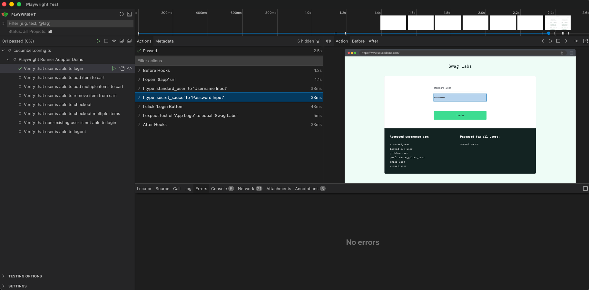

# @qavajs/playwright
qavajs implementation on top of playwright runner



Demo projects:
- https://github.com/qavajs/demo/tree/main/playwright-runner

## Installation

```shell
npm init playwright
```              

```shell
npm install @qavajs/playwright
```

## Configuration
qavajs.config.ts
```typescript
import { defineConfig } from '@qavajs/playwright';
import Memory from './memory';
import App from './page_object';

export default defineConfig({
    paths: ['features/*.feature'],
    require: [
        'node_modules/@qavajs/playwright/steps.js', // package steps
        'step_definitions/*.ts' // custom step definitions
    ],
    memory: new Memory(),
    pageObject: new App()
});
```

playwright.config.ts
```typescript
import { defineConfig } from '@playwright/test';

export default defineConfig({
    testMatch: 'qavajs.config.ts',
    ...
});
```

:::note
Requires Node.js 22 or later. Only `@qavajs/playwright`, `@qavajs/playwright/steps.js` and `@qavajs/playwright/lib/electron.js` entry points can be imported.
:::

## Page Object

```typescript
import { locator } from '@qavajs/playwright';

class LoginPage {
    UsernameInput = locator('#username');
    // template selector - argument is passed via 'ElementName(arg)' syntax in steps
    RowByText = locator.template((text: string) => `tr:has-text("${text}")`);
    // native playwright locator
    ActiveTab = locator.native(({ page }) => page.locator('.tab.active'));
}

export default class App {
    LoginPage = locator('#login').as(LoginPage);
}
```

More details in [page object](../Commons/page-object.mdx) section.

## Parameter Types

| type                 | description                                                                                                                                |
|----------------------|--------------------------------------------------------------------------------------------------------------------------------------------|
| `{value}`            | quoted string resolved via memory                                                                                                          |
| `{locator}`          | quoted page object alias resolved to playwright locator                                                                                    |
| `{validation}`       | validation (e.g. _to equal_, _not to contain_, _to softly match_) [(validation)](../Commons/validation.mdx)                                 |
| `{state}`            | element state: _present_, _clickable_, _visible_, _invisible_, _enabled_, _disabled_, _in viewport_ (e.g. _to be visible_, _not to be softly present_) |
| `{mouseButton}`      | `left`, `right` or `middle`                                                                                                                |
| `{browserButton}`    | `back` or `forward`                                                                                                                        |
| `{storageType}`      | `local` or `session`                                                                                                                       |
| `{bodyParsingType}`  | `json`, `text` or `buffer`                                                                                                                 |
| `{gqlRequestProperty}` | `query` or `variables`                                                                                                                   |

## Custom Steps

Custom steps are defined with `Given`/`When`/`Then` exported from `@qavajs/playwright` and can reuse built-in parameter types and world helpers

| World member                                                  | Description                                            |
|---------------------------------------------------------------|--------------------------------------------------------|
| `this.page`, `this.context`, `this.browser`, `this.request`   | Playwright objects of current scenario                 |
| `this.element(path)`                                          | Resolve page object path to `Locator`                  |
| `this.value(expression)`                                      | Resolve memory expression (`'$user'`, `'$js(1 + 1)'`)  |
| `this.setValue(key, value)`                                   | Save value to memory                                   |
| `this.expect`                                                 | Playwright `expect` extended with qavajs matchers      |
| `this.waitForDialog()`                                        | Get open dialog or wait for next one                   |
| `this.log(data)`, `this.attach(data, details)`                | Add log or attachment to report                        |

```typescript
import { When, Then, type QavajsPlaywrightWorld, type MemoryValue, type Validation } from '@qavajs/playwright';
import type { Locator } from '@playwright/test';

When('I log in as {value}', async function (this: QavajsPlaywrightWorld, user: MemoryValue) {
    const { username, password } = await user.value();
    await this.element('LoginPage > UsernameInput').fill(username);
    await this.element('LoginPage > PasswordInput').fill(password);
});

Then('I expect placeholder of {locator} {validation} {value}', async function (
    this: QavajsPlaywrightWorld,
    locator: Locator,
    validation: Validation,
    expected: MemoryValue
) {
    // poll retries until validation passes or expect timeout is reached
    await validation.poll(() => locator.getAttribute('placeholder'), await expected.value());
});
```

## Action Steps

### I open \{string} url

Opens provided url

| param |  type  |   description   |
|:-----:|:------:|:---------------:|
|  url  | string | url to navigate |

```gherkin
When I open 'https://google.com' url
```
---
### I type \{string} (in)to \{string}

Type text to element

| param |  type  |   description   |
|:-----:|:------:|:---------------:|
| alias | string | element to type |
| value | string |  value to type  |

```gherkin
When I type 'wikipedia' to 'Google Input'
When I type 'wikipedia' into 'Google Input'
```
---
### I type \{string} chars (in)to \{string}

Type text to element sending fine-grained keyboard events

| param |  type  |   description   |
|:-----:|:------:|:---------------:|
| alias | string | element to type |
| value | string |  value to type  |

```gherkin
When I type 'wikipedia' chars to 'Google Input'
When I type 'wikipedia' chars into 'Google Input'
```
---
### I click \{string}

Click element

| param |  type  |   description    |
|:-----:|:------:|:----------------:|
| alias | string | element to click |

```gherkin
When I click 'Google Button'
```
---
### I right click \{string}

Right click element

| param |  type  |   description    |
|:-----:|:------:|:----------------:|
| alias | string | element to click |

```gherkin
When I right click 'Google Button'
```
---
### I double click \{string}

Double click element

| param |  type  |   description    |
|:-----:|:------:|:----------------:|
| alias | string | element to click |

```gherkin
When I double click 'Google Button'
```
---
### I tap \{string}

Tap element

| param |  type  |  description   |
|:-----:|:------:|:--------------:|
| alias | string | element to tap |

```gherkin
When I tap 'Google Button'
```
---
### I clear \{string}

Clear element

| param |  type  |   description    |
|:-----:|:------:|:----------------:|
| alias | string | element to clear |

```gherkin
When I clear 'Search Input'
```
---
### I click \{string} text in \{string} collection

Click on element with desired text in collection

|    param     |  type  |  description  |
|:------------:|:------:|:-------------:|
| expectedText | string | text to click |
|    alias     | string |  collection   |

```gherkin
When I click 'google' text in 'Search Engines' collection
```

---
### I switch to \{int} window

Switch to window by index

| param |  type  |      description       |
|:-----:|:------:|:----------------------:|
| index | number | window index to switch |

```gherkin
When I switch to 2 window
```

---
### I switch to \{string} window

Switch to window by matcher

|  param  |  type  |          description          |
|:-------:|:------:|:-----------------------------:|
| matcher | string | window matcher (url or title) |

```gherkin
When I switch to 'google.com' window
```

---
### I open new tab

Open new browser tab

```gherkin
When I open new tab
```

---
### I close current tab

Close current browser tab

```gherkin
When I close current tab
```

---
### I refresh page

Refresh page

```gherkin
When I refresh page
```

---
### I press \{string} key(s)

Press key

| param |  type  | description  |
|:-----:|:------:|:------------:|
|  key  | string | key to press |

```gherkin
When I press 'Enter' key
```

---
### I press \{string} key(s) \{int} time(s)

Press button given number of times

| param  |  type  |   description   |
|:------:|:------:|:---------------:|
|  key   | string |  key to press   |
| number | number | number of times |

```gherkin
I press 'Enter' key 5 times
I press 'Space' key 4 times
```

---
### I hover over \{string}

Hover over element

| param |  type  |      description      |
|:-----:|:------:|:---------------------:|
| alias | string | element to hover over |

```gherkin
When I hover over 'Google Button'
```

---
### I select \{string} option from \{string} dropdown

Select option with certain text from select element

| param  |  type  |   description    |
|:------:|:------:|:----------------:|
| option | string | option to select |
| alias  | string | alias of select  |

```gherkin
When I select '1900' option from 'Registration Form > Date Of Birth'
When I select '$dateOfBirth' option from 'Registration Form > Date Of Birth' dropdown
```
  
---
### I select \{int}(st|nd|rd|th) option from \{string} dropdown

Select option with certain index from select element

|    param    |  type  |        description        |
|:-----------:|:------:|:-------------------------:|
| optionIndex | number | index of option to select |
|    alias    | string |      alias of select      |

```gherkin
When I select 1 option from 'Registration Form > Date Of Birth' dropdown
```

---
### I accept alert

Accepts an alert

```gherkin
When I accept alert
```

---
### I dismiss alert

Dismisses an alert

```gherkin
When I dismiss alert
```

---
### I type \{string} to alert

Type a text to alert

| param |  type  |  description  |
|:-----:|:------:|:-------------:|
| value | string | value to type |

```gherkin
When I type 'coffee' to alert
```

---
### I upload \{string} file to \{string}

Provide file url to upload input

| param |  type  |      description       |
|:-----:|:------:|:----------------------:|
| alias | string | element to upload file |
| value | string |       file path        |

```gherkin
When I upload '/folder/file.txt' file to 'File Input'
```
 
---
### I scroll by \{string}

Scroll by offset

| param  |  type  |          description           |
|:------:|:------:|:------------------------------:|
| offset | string | offset string in 'x, y' format |

```gherkin
When I scroll by '0, 100'
```

---
### I scroll to \{string}

Scroll to element

| param |  type  |   description    |
|:-----:|:------:|:----------------:|
| alias | string | alias of element |

```gherkin
When I scroll to 'Element'
```

---
### I scroll by \{string} in \{string}

Scroll by offset in element

| param  |  type  |          description           |
|:------:|:------:|:------------------------------:|
| offset | string | offset string in 'x, y' format |
| alias  | string |        alias of element        |

```gherkin
When I scroll by '0, 100' in 'Overflow Container'
```

-------------------------
### I scroll until \{string} to be visible

Scroll page by mouse wheel until element becomes visible (limited by expect timeout)

| param |  type  |  description   |
|:-----:|:------:|:--------------:|
| alias | string | target element |

```gherkin
When I scroll until 'Row 99' to be visible
```

---
### I scroll in \{string} until \{string} to be visible

Scroll in container by mouse wheel until element becomes visible (limited by expect timeout)

| param  |  type  |   description    |
|:------:|:------:|:----------------:|
| scroll | string | scroll container |
| target | string |  target element  |

```gherkin
When I scroll in 'List' until 'Row 99' to be visible
```

---
### I drag and drop \{string} to \{string}

Drag&Drop one element to another

|    param     |  type  |   description   |
|:------------:|:------:|:---------------:|
| elementAlias | string | element to drop |
| targetAlias  | string |     target      |

```gherkin
When I drag and drop 'Bishop' to 'E4'
```

_________________________
### I define \{string} as \{string} locator

Register selector as page object element in the root of page object.
The alias stays available to scenarios that run later in the same worker.

|    param    |  type  |     description      |
|:-----------:|:------:|:--------------------:|
| selectorKey | string | selector to register |
|  aliasKey   | string |   alias of element   |

```gherkin
When I define '#someId' as 'My Button' locator
And I click 'My Button'
When I define 'li.selected' as 'Selected Items' locator
And I expect number of elements in 'Selected Items' collection to equal '3'
```

-------------------------
### I press \{mouseButton} mouse button

Press mouse button

| param  |  type  |              description              |
|:------:|:------:|:-------------------------------------:|
| button | string | button to press (left, right, middle) |

```gherkin
When I press left mouse button
```

-------------------------
### I release \{mouseButton} mouse button

Release mouse button

| param  |  type  |               description               |
|:------:|:------:|:---------------------------------------:|
| button | string | button to release (left, right, middle) |

```gherkin
When I release left mouse button
```

-------------------------
### I move mouse to \{string}

Move mouse to coordinates

|    param    |  type  |       description        |
|:-----------:|:------:|:------------------------:|
| coordinates | string | x, y coordinates to move |

```gherkin
When I move mouse to '10, 15'
```

-------------------------
### I scroll mouse wheel by \{string}

Scroll mouse wheel by x, y offset

|    param    |  type  |      description      |
|:-----------:|:------:|:---------------------:|
| coordinates | string | x, y offset to scroll |

```gherkin
When I scroll mouse wheel by '0, 15'
```

-------------------------
### I hold down \{string} key

Press and hold keyboard key

| param |  type  | description  |
|:-----:|:------:|:------------:|
|  key  | string | key to press |

```gherkin
When I hold down 'Q' key
```

-------------------------
### I release \{string} key

Release keyboard key

| param |  type  |  description   |
|:-----:|:------:|:--------------:|
|  key  | string | key to release |

```gherkin
When I release 'Q' key
```

---
### I click \{browserButton} button

Click browser button

| param  |  type  |          description           |
|:------:|:------:|:------------------------------:|
| button | string | browser button (back, forward) |

```gherkin
When I click back button
When I click forward button
```

---
### I upload \{string} file by clicking \{string}

Provide file url to file chooser

| param |  type  |            description            |
|:-----:|:------:|:---------------------------------:|
| file  | string |     file path or file handle      |
| alias | string | element that invokes file chooser |

```gherkin
When I upload '/folder/file.txt' file by clicking 'Upload Button'
```

---
### I upload files by clicking \{string}: [DataTable]

Provide multiple files to file chooser

|   param   |   type    |            description            |
|:---------:|:---------:|:---------------------------------:|
|   alias   |  string   | element that invokes file chooser |
| dataTable | DataTable |          list of file paths       |

```gherkin
When I upload files by clicking 'Upload Button':
  | /folder/file1.txt |
  | /folder/file2.txt |
```

---
### I save file to \{string} by clicking \{string}

Save downloaded file to certain path

| param |  type  |           description            |
|:-----:|:------:|:--------------------------------:|
| path  | string |            file path             |
| alias | string | element that invokes downloading |

```gherkin
When I save file to './folder/file.pdf' by clicking 'Download Button'
```

---
### I set window size \{string}

Resize browser viewport

|    param     |  type  |                  description                  |
|:------------:|:------:|:---------------------------------------------:|
| viewportSize | string | width and height in pixels separated by comma |


```gherkin
When I set window size '1440,900'
```

---
### I click \{string} coordinates in \{string}

Click a certain coordinate of an element

|    param    |  type  |             description             |
|:-----------:|:------:|:-----------------------------------:|
| coordinates | string | comma separated x and y coordinates |
|    alias    | string |          element to click           |


```gherkin
When I click '0,20' coordinates in 'Google Button'
```

---
### I force click \{string}

Force click element

| param |  type  |   description    |
|:-----:|:------:|:----------------:|
| alias | string | element to click |

```gherkin
When I force click 'Google Button'
```
---

## Validation Steps

---
### I expect \{string} \{state}

Verify that element satisfies certain condition

|     param     |  type  |        description         |             example              |
|:-------------:|:------:|:--------------------------:|:--------------------------------:|
|     alias     | string | element to check condition |           Search Input           |
| conditionWait | string | function to wait condition | to be visible, not to be present |

```gherkin
Then I expect 'Header' to be visible
Then I expect 'Loading' not to be present
```

---
### I expect number of elements in \{string} collection \{validation} \{string}

Verify that number of element in collection satisfies condition

|     param     |  type  |          description          |                example                |
|:-------------:|:------:|:-----------------------------:|:-------------------------------------:|
|  collection   | string | collection to check condition |            Search Results             |
|  validation   | string | function to verify condition  | to be equal, to be above, to be below |
| expectedValue | string |        expected value         |                                       |

```gherkin
Then I expect number of elements in 'Search Results' collection to be equal '50'
Then I expect number of elements in 'Search Results' collection to be above '49'
Then I expect number of elements in 'Search Results' collection to be below '51'
```

---
### I expect text of \{string} \{validation} \{string}

Verify that text of element satisfies condition

|     param     |  type  |        description         |                example                |
|:-------------:|:------:|:--------------------------:|:-------------------------------------:|
|     alias     | string | element to check condition |  Label, #1 of Search Results > Title  |
|  validation   | string |      validation type       | to be equal, to contain, not to match |
| expectedValue | string |      expected result       |                                       |

```gherkin
Then I expect text of '#1 of Search Results' to be equal 'google'
Then I expect text of '#1 of Search Results' to be equal '$firstResult'
```
---
### I expect value of \{string} \{validation} \{string}

Verify that value of element satisfies condition

|     param     |  type  |        description         |                example                |
|:-------------:|:------:|:--------------------------:|:-------------------------------------:|
|     alias     | string | element to check condition |           Input, Text Area            |
|  validation   | string |      validation type       | to be equal, to contain, not to match |
| expectedValue | string |      expected result       |                                       |

```gherkin
Then I expect value of 'Input' to be equal 'google'
Then I expect value of '#1 of Textareas' to be equal '$firstResult'
```
---
### I expect \{string} property of \{string} \{validation} \{string}

Verify that property of element satisfies condition

|     param     |  type  |        description         |                example                |
|:-------------:|:------:|:--------------------------:|:-------------------------------------:|
|   property    | string |  property check condition  |    value, href, checked, innerHTML    |
|     alias     | string | element to check condition |  Label, #1 of Search Results > Title  |
|  validation   | string |      validation type       | to be equal, to contain, not to match |
| expectedValue | string |      expected result       |                                       |

```gherkin
Then I expect 'value' property of 'Search Input' to be equal 'text'
Then I expect 'innerHTML' property of 'Label' to contain '<b>'
Then I expect 'value' property of 'Search Input' to be equal '$inputText'
```
---
### I expect \{string} attribute of \{string} \{validation} \{string}

Verify that attribute of element satisfies condition

|     param     |  type  |        description         |                example                |
|:-------------:|:------:|:--------------------------:|:-------------------------------------:|
|   attribute   | string | attribute check condition  |             href, checked             |
|     alias     | string | element to check condition |  Label, #1 of Search Results > Title  |
|  validation   | string |      validation type       | to be equal, to contain, not to match |
| expectedValue | string |      expected result       |                                       |

```gherkin
Then I expect 'href' attribute of 'Home Link' to contain '/home'
Then I expect 'href' attribute of 'Home Link' to be equal '$url'
```

---
### I expect \{string} custom property of \{string} \{validation} \{string}

Verify that result of custom function executed on element satisfies validation

|     param     |  type  |                 description                  |                example                |
|:-------------:|:------:|:--------------------------------------------:|:-------------------------------------:|
|   property    | string | function that accepts element as argument    |  $js(element => element.value)        |
|     alias     | string |              element to verify               |                Search Input           |
|  validation   | string |         function to verify condition         | to be equal, to be above, to be below |
| expectedValue | string |               expected result                |                                       |

```gherkin
Then I expect '$js(element => element.value)' custom property of 'Element' to be equal '123'
```

---
### I expect current url \{validation} \{string}

Verify that current url satisfies condition

|     param     |  type  |        description         |                example                |
|:-------------:|:------:|:--------------------------:|:-------------------------------------:|
|  validation   | string |      validation type       | to be equal, to contain, not to match |
| expectedValue | string |      expected result       |                                       |

```gherkin
Then I expect current url contains 'wikipedia'
Then I expect current url equals 'https://wikipedia.org'
```

---
### I expect page title \{validation} \{string}

Verify that page title satisfies condition

|     param     |  type  |        description         |                example                |
|:-------------:|:------:|:--------------------------:|:-------------------------------------:|
|  validation   | string |      validation type       | to be equal, to contain, not to match |
| expectedValue | string |      expected result       |                                       |

```gherkin
Then I expect page title equals 'Wikipedia'
```
---
### I expect every element in \{string} collection \{state}

Verify that all elements in collection satisfy condition

|   param   |  type  |     description     |           example            |
|:---------:|:------:|:-------------------:|:----------------------------:|
|   alias   | string | alias of collection |        Search Results        |
| condition | string |  condition to wait  | to be visible, to be present |

```gherkin
Then I expect every element in 'Header > Links' collection to be visible
Then I expect every element in 'Loading Bars' collection not to be present
```

---
### I expect text of every element in \{string} collection \{validation} \{string}

Verify that all texts in collection satisfy condition

Note: step passes in case of empty collection

|     param     |  type  |     description     |                example                |
|:-------------:|:------:|:-------------------:|:-------------------------------------:|
|     alias     | string | alias of collection |            Search Results             |
|  validation   | string |   validation type   | to be equal, to contain, not to match |
| expectedValue | string |   expected result   |                                       |

```gherkin
Then I expect text of every element in 'Search Results' collection equals to 'google'
Then I expect text of every element in 'Search Results' collection does not contain 'google'
```

---
### I expect \{string} attribute of every element in \{string} collection \{validation} \{string}

Verify that all particular attributes in collection satisfy condition

Note: step passes in case of empty collection

|     param     |  type  |     description     |                example                |
|:-------------:|:------:|:-------------------:|:-------------------------------------:|
|   attribute   | string |  attribute to get   |             href, checked             |
|     alias     | string | alias of collection |            Search Results             |
|  validation   | string |   validation type   | to be equal, to contain, not to match |
| expectedValue | string |   expected result   |                                       |

```gherkin
Then I expect 'href' attribute of every element in 'Search Results' collection to contain 'google'
```

---
### I expect \{string} property of every element in \{string} collection \{validation} \{string}

Verify that all particular properties in collection satisfy condition

Note: step passes in case of empty collection

|     param     |  type  |     description     |                example                |
|:-------------:|:------:|:-------------------:|:-------------------------------------:|
|   attribute   | string |  attribute to get   |             href, checked             |
|     alias     | string | alias of collection |            Search Results             |
|  validation   | string |   validation type   | to be equal, to contain, not to match |
| expectedValue | string |   expected result   |                                       |

```gherkin
Then I expect 'href' property of every element in 'Search Results' collection to contain 'google'
```

### I expect \{string} custom property of every element in \{string} collection \{validation} \{string}

Verify that result of custom function executed on every element in collection satisfies validation

|     param     |  type  |                 description                  |                example                |
|:-------------:|:------:|:--------------------------------------------:|:-------------------------------------:|
|   property    | string | function that accepts element as argument    |   $js(element => element.nodeName)    |
|     alias     | string |             collection to verify             |              Search Results           |
|  validation   | string |         function to verify condition         | to be equal, to be above, to be below |
| expectedValue | string |               expected result                |                                       |

```gherkin
Then I expect '$js(element => element.nodeName)' custom property of every element in 'Collection' collection to equal 'LI'
```

---
### I expect \{string} css property of \{string} \{validation} \{string}

Verify that css property of element satisfies condition

|     param     |  type  |        description         |                example                |
|:-------------:|:------:|:--------------------------:|:-------------------------------------:|
|   property    | string |  property check condition  |           color, font-size            |
|     alias     | string | element to check condition |  Label, #1 of Search Results > Title  |
|  validation   | string |      validation type       | to be equal, to contain, not to match |
| expectedValue | string |      expected result       |                                       |

```gherkin
Then I expect 'color' css property of 'Search Input' to be equal 'rgb(42, 42, 42)'
Then I expect 'font-family' css property of 'Label' to contain 'Fira'
```

---
### I expect text of alert \{validation} \{string}

Verify that text of an alert meets expectation

|     param     |  type  |         description          |                example                |
|:-------------:|:------:|:----------------------------:|:-------------------------------------:|
|  validation   | string | function to verify condition | to be equal, to be above, to be below |
| expectedValue | string |       expected result        |                                       |

```gherkin
Then I expect text of alert does not contain 'coffee'
Then I expect text of alert does not contain 'hello world'
Then I expect text of alert does not contain 'Are you sure you want to leave this page?'
```

---
### I expect \{string} \{validation} \{string}

Verify that value from memory satisfies validation against other value

|   param    |   type   |         description          |                example                |
|:----------:|:--------:|:----------------------------:|:-------------------------------------:|
|   value1   |   any    |            value1            |      42, $value, $currentDate()       |
| validation | Function | function to verify condition | to be equal, to be above, to be below |
|   value2   |   any    |            value2            |      42, $value, $currentDate()       |

```gherkin
Then I expect '$value' to equal '$anotherValue'
Then I expect '$value' not to contain '56'
```

---
### I expect every element in \{string} array \{validation} \{string}

Verify that every element in array satisfies validation against other value

```gherkin
Then I expect every element in '$arr' array to be above '50'
```

---
### I expect at least \{int} element(s) in \{string} array \{validation} \{string}

Verify that at least x elements in array pass validation

```gherkin
Then I expect at least 2 elements in '$arr' array to be above '50'
```

---
### I expect \{string} array to be sorted by \{string}

Verify that array is sorted by provided comparator function

```gherkin
Then I expect '$arr' array to be sorted by '$ascending'
```

---
### I expect \{string} array \{validation}: [DataTable]

Verify that array satisfies validation against array provided as data table

```gherkin
Then I expect '$arr' array to have members:
  | uno  |
  | dos  |
  | tres |
```

---
### I expect \{string} \{validation} at least one of \{string}

Verify that value satisfies validation with at least one value from the array

```gherkin
Then I expect '$value' to equal at least one of '$js([1, 2, 3])'
```

---
### I expect \{string} \{validation} at least one of: [DataTable]

Verify that value satisfies validation with at least one value from the data table

```gherkin
Then I expect '$value' to equal at least one of:
  | 1 |
  | 2 |
```

---
### I expect \{string} \{validation} all of \{string}

Verify that value satisfies validation with all values from the array

```gherkin
Then I expect '$value' not to equal all of '$js([1, 2, 3])'
```

---
### I expect \{string} \{validation} all of: [DataTable]

Verify that value satisfies validation with all values from the data table

```gherkin
Then I expect '$value' to contain all of:
  | a |
  | b |
```

## Memory Steps
 
---
### I save text of \{string} as \{string}

Save text of element to memory

| param |  type  |     description      |               example               |
|:-----:|:------:|:--------------------:|:-----------------------------------:|
| alias | string | element to get value | Label, #1 of Search Results > Title |
|  key  | string |  key to store value  |                                     |

```gherkin
When I save text of '#1 of Search Results' as 'firstSearchResult'
```
---
### I save value of \{string} as \{string}

Save value of input element to memory

| param |  type  |       description       |   example    |
|:-----:|:------:|:-----------------------:|:------------:|
| alias | string | element to get value    | Search Input |
|  key  | string |   key to store value    |    query     |

```gherkin
When I save value of 'Search Input' as 'query'
```

---
### I save \{string} property of \{string} as \{string}

Save property of element to memory

|  param   |  type  |     description      |               example               |
|:--------:|:------:|:--------------------:|:-----------------------------------:|
| property | string |  property to store   |   value, href, checked, innerHTML   |
|  alias   | string | element to get value | Label, #1 of Search Results > Title |
|   key    | string |  key to store value  |                                     |


```gherkin
When I save 'checked' property of 'Checkbox' as 'checked'
When I save '$prop' property of 'Checkbox' as 'checked'
```
---
### I save \{string} attribute of \{string} as \{string}

Save attribute of element to memory

|   param   |  type  |     description      |               example               |
|:---------:|:------:|:--------------------:|:-----------------------------------:|
| attribute | string |  attribute to store  |            href, checked            |
|   alias   | string | element to get value | Label, #1 of Search Results > Title |
|    key    | string |  key to store value  |                                     |

```gherkin
When I save 'href' attribute of 'Link' as 'linkHref'
When I save '$prop' attribute of 'Link' as 'linkHref'
```
---
### I save number of elements in \{string} collection as \{string}

Save number of elements in collection to memory

|   param    |  type  |       description       |    example     |
|:----------:|:------:|:-----------------------:|:--------------:|
| collection | string | collection to get value | Search Results |
|    key     | string |   key to store value    |                |

```gherkin
When I save number of elements in 'Search Results' collection as 'numberOfSearchResults'
```

---
### I save text of every element of \{string} collection as \{string}

Save array of texts of collection to memory

| param |  type  |       description       |    example     |
|:-----:|:------:|:-----------------------:|:--------------:|
| alias | string | collection to get value | Search Results |
|  key  | string |   key to store value    |                |

```gherkin
When I save text of every element of 'Search Results' collection as 'searchResults'
```

---
### I save \{string} attribute of every element of \{string} collection as \{string}

Save array of attributes of collection to memory

|   param   |  type  |       description       |    example     |
|:---------:|:------:|:-----------------------:|:--------------:|
| attribute | string | attribute to get value  | checked, href  |
|   alias   | string | collection to get value | Search Results |
|    key    | string |   key to store value    |                |

```gherkin
When I save 'checked' attribute of every element of 'Search > Checkboxes' collection as 'checkboxes'
```

---
### I save \{string} property of every element of \{string} collection as \{string}

Save array of properties of collection to memory

|  param   |  type  |       description       |    example     |
|:--------:|:------:|:-----------------------:|:--------------:|
| property | string |  property to get value  |      href      |
|  alias   | string | collection to get value | Search Results |
|   key    | string |   key to store value    |                |

```gherkin
When I save 'href' property of every element of 'Search Results' collection as 'hrefs'
```

---
### I save \{string} custom property of \{string} as \{string}

Save result of custom function executed on element to memory

```gherkin
When I save '$js(element => element.value)' custom property of 'Element' as 'value'
```

---
### I save \{string} custom property of every element of \{string} collection as \{string}

Save array of results of custom function executed on every element of collection to memory

```gherkin
When I save '$js(element => element.nodeName)' custom property of every element of 'Collection' collection as 'nodeNames'
```

---
### I save current url as \{string}

Save current url to memory

|  param   |  type  |       description       |    example     |
|:--------:|:------:|:-----------------------:|:--------------:|
|   key    | string |   key to store value    |                |

```gherkin
When I save current url as 'currentUrl'
```
 
---
### I save page title as \{string}

Save current page title to memory

|  param   |  type  |       description       |    example     |
|:--------:|:------:|:-----------------------:|:--------------:|
|   key    | string |   key to store value    |                |

```gherkin
When I save page title as 'currentTitle'
```

### I save \{string} css property of \{string} as \{string}

Save css property of element to memory

|  param   |  type  |     description      |               example               |
|:--------:|:------:|:--------------------:|:-----------------------------------:|
| property | string |  property to store   |     background-color, font-size     |
|  alias   | string | element to get value | Label, #1 of Search Results > Title |
|   key    | string |  key to store value  |                                     |


```gherkin
When I save 'color' css property of 'Checkbox' as 'checkboxColor'
When I save '$propertyName' property of 'Checkbox' as 'checkboxColor'
```
     
---
### I save screenshot as \{string}

Save page screenshot into memory

| param |  type  |    description     |
|:-----:|:------:|:------------------:|
|  key  | string | key to store value |

```gherkin
When I save screenshot as 'screenshot'
```

---
### I save full page screenshot as \{string}

Save full page screenshot into memory

| param |  type  |    description     |
|:-----:|:------:|:------------------:|
|  key  | string | key to store value |

```gherkin
When I save full page screenshot as 'screenshot'
```

---
### I save screenshot of \{string} as \{string}

Save element screenshot into memory

| param |  type  |        description        |
|:-----:|:------:|:-------------------------:|
|  key  | string |    key to store value     |
| alias | string | element to get screenshot |

```gherkin
When I save screenshot of 'Element' as 'screenshot'
```

---
### I save bounding rect of \{string} as \{string}

Save bounding client rect to memory
https://developer.mozilla.org/en-US/docs/Web/API/DOMRect

| param |  type  |         description          |
|:-----:|:------:|:----------------------------:|
| alias | string | element to get bounding rect |
|  key  | string |      key to store value      |

```gherkin
When I save bounding rect of 'Node' as 'boundingRect'
Then I expect '$boundingRect.width' to equal '42'
```

---
### I save \{string} to memory as \{string}

Save value to memory

```gherkin
When I save '42' to memory as 'answer'
When I save '$js(Date.now())' to memory as 'timestamp'
```

---
### I set \{string} = \{string}

Save value to memory (alias of `I save {value} to memory as {value}`)

```gherkin
When I set 'answer' = '42'
```

---
### I save multiline string to memory as \{string}: [Multiline]

Save multiline string to memory

```gherkin
When I save multiline string to memory as 'text':
  """
  first line
  second line
  """
```

---
### I save json to memory as \{string}: [Multiline]

Parse json and save it to memory

```gherkin
When I save json to memory as 'payload':
  """
  { "name": "qavajs" }
  """
```

---
### I save key-value pairs to memory as \{string}: [DataTable]

Save data table as object to memory

```gherkin
When I save key-value pairs to memory as 'user':
  | name | qavajs |
  | role | admin  |
```

## Wait Steps

---
### I wait \{int} ms

Wait for specified number of milliseconds

```gherkin
When I wait 1000 ms
```

:::note
`until` steps repeat action every 5 seconds until condition is met, up to 60 seconds.
:::

---
### I click \{string} until \{string} \{state}

Repeatedly click element until other element matches state

```gherkin
When I click 'Refresh Button' until 'Order Status' to be visible
```

---
### I click \{string} until text of \{string} \{validation} \{string}

Repeatedly click element until text of other element matches condition

```gherkin
When I click 'Send Message Button' until text of 'Information Alert' to be equal 'Your account has been banned'
```

---
### I click \{string} until value of \{string} \{validation} \{string}

Repeatedly click element until value of other element matches condition

```gherkin
When I click 'Plus Button' until value of 'Quantity Input' to be equal '9'
```

---
### I refresh page until \{string} \{state}

Refresh page until element matches state

```gherkin
When I refresh page until 'Internal Server Error Box' to be visible
```

---
### I refresh page until text of \{string} \{validation} \{string}

Refresh page until element text matches condition

```gherkin
When I refresh page until text of 'Order Status' to be equal 'Processing'
```

---
### I refresh page until value of \{string} \{validation} \{string}

Refresh page until element value matches condition

```gherkin
When I refresh page until value of 'Order Status Input' to be equal 'Processing'
```

## Execute Steps

---
### I execute \{string} function

Execute client function

|    param    |  type  |          description           |
|:-----------:|:------:|:------------------------------:|
| functionKey | string | function memory key to execute |

```gherkin
When I execute '$fn' function # fn is function reference
When I execute 'window.scrollBy(0, 100)' function
```

---
### I execute \{string} function and save result as \{string}

Execute client function and save result into memory

|    param    |  type  |          description           |
|:-----------:|:------:|:------------------------------:|
| functionKey | string | function memory key to execute |
|  memoryKey  | string |    memory key to save value    |

```gherkin
When I execute '$fn' function and save result as 'result' # fn is function reference
When I execute 'window.scrollY' function and save result as 'scroll'
```

---
### I execute \{string} function on \{string}

Execute client function on certain element

|    param    |  type  |          description           |
|:-----------:|:------:|:------------------------------:|
| functionKey | string | function memory key to execute |
|    alias    | string |      target element alias      |

```gherkin
When I execute '$fn' function on 'Component > Element' # fn is function reference
When I execute 'arguments[0].scrollIntoView()' function on 'Component > Element'
```

---
### I execute \{string} function on \{string} and save result as \{string}

Execute client function on certain element

|    param    |  type  |          description           |
|:-----------:|:------:|:------------------------------:|
| functionKey | string | function memory key to execute |
|  memoryKey  | string |    memory key to save value    |
|    alias    | string |      target element alias      |

```gherkin
When I execute '$fn' function on 'Component > Element' and save result as 'innerText' # fn is function reference
When I execute 'arguments[0].innerText' function on 'Component > Element' and save result as 'innerText'
```

## Electron Steps

Electron apps are tested with the same steps as web pages, plus electron steps.
The app is launched by `QavajsPlaywrightElectronWorld` using `launchOptions` of the Playwright project,
and `this.page` is the first window of the app.

qavajs.config.ts
```typescript
export default defineConfig({
    require: [
        'node_modules/@qavajs/playwright/steps.js', // built-in step definitions
        'node_modules/@qavajs/playwright/lib/electron.js', // electron step definitions
        'step_definitions/*.ts' // custom step definitions incl. world setup (must go after steps.js)
    ],
});
```

step_definitions/setup.ts
```typescript
import { setWorldConstructor, QavajsPlaywrightElectronWorld } from '@qavajs/playwright';

setWorldConstructor(QavajsPlaywrightElectronWorld);
```

playwright.config.ts
```typescript
import { defineConfig } from '@playwright/test';

export default defineConfig({
    testMatch: 'qavajs.config.ts',
    projects: [
        {
            name: 'electron',
            use: {
                launchOptions: {
                    args: ['path/to/main.js']
                }
            },
        }
    ]
});
```

In custom steps, the Electron main process is available as `this.electron`.

---
### I execute \{string} function/script on electron app

Execute function on electron main process

```gherkin
When I execute '$js(async ({ app }) => app.getAppPath())' function on electron app
```

---
### I execute \{string} function/script on electron app and save result as \{string}

Execute function on electron main process and save result into memory

```gherkin
When I execute '$js(async ({ app }) => app.getAppPath())' function on electron app and save result as 'path'
```

---
### I click \{string} electron menu

Click electron application menu item

```gherkin
When I click 'File > Edit' electron menu
```

## Mock Steps

---
### I create mock for \{string} as \{string}

Create mock instance

|    param    |  type  |            description            |
|:-----------:|:------:|:---------------------------------:|
| urlTemplate | string |  minimatch url template to mock   |
|  memoryKey  | string | memory key to store mock instance |

```gherkin
When I create mock for '/yourservice/**' as 'mock1'
When I create mock for '$mockUrlTemplate' as 'mock1'
```

---
### I set \{string} mock to respond \{string} with: [multiline]

Add mocking rule to respond with desired status code and payload

|   param    |  type  |           description           |
|:----------:|:------:|:-------------------------------:|
|  mockKey   | string | memory key to get mock instance |
| statusCode | string |           status code           |
|    body    | string |          response body          |

```gherkin
When I create mock for '/yourservice/**' as 'myServiceMock'
And I set '$myServiceMock' mock to respond '200' with:
"""
{
    "status": "success"
}
"""
```

---
### I set \{string} mock to respond \{string} with \{string}

Add mocking rule to respond with desired status code and payload

|   param    |  type  |           description           |
|:----------:|:------:|:-------------------------------:|
|  mockKey   | string | memory key to get mock instance |
| statusCode | string |           status code           |
|    body    | string |          response body          |

```gherkin
When I create mock for '/yourservice/**' as 'myServiceMock'
And I set '$myServiceMock' mock to respond '200' with '$response'
```

---
### I set \{string} mock to abort with \{string} reason

Add mocking rule to abort request with certain reason

|  param  |  type  |                                description                                |
|:-------:|:------:|:-------------------------------------------------------------------------:|
| mockKey | string |                      memory key to get mock instance                      |
| reason  | string | reason string see https://playwright.dev/docs/api/class-route#route-abort |

```gherkin
When I create mock for '/yourservice/**' as 'myServiceMock'
And I set '$myServiceMock' mock to abort with 'Failed' reason
```

---
### I restore \{string} mock

Restore mock

|  param  |  type  |                        description                         |
|:-------:|:------:|:----------------------------------------------------------:|
| mockKey | string |              memory key to get mock instance               |

```gherkin
When I restore '$myServiceMock'
```

---
### I restore all mocks

Restore all mocks

```gherkin
When I restore all mocks
```

## Cookie Steps

---
### I set \{string} cookie as \{string}

Set cookie

| param  |  type  | description  |
|:------:|:------:|:------------:|
| cookie | string | cookie name  |
| value  | string | value to set |

```gherkin
When I set 'userID' cookie as 'user1'
When I set 'userID' cookie as '$userIdCookie'
```
   
---
### I save value of \{string} cookie as \{string}

Save cookie value to memory

| param  |  type  | description |
|:------:|:------:|:-----------:|
| cookie | string | cookie name |
|  key   | string | memory key  |

```gherkin
When I save value of 'auth' cookie as 'authCookie'
```

## Local/Session Storage Steps

---
### I set \{string} \{storageType} storage value as \{string}

Set value of local/session storage

|    param    |  type  |              description               |
|:-----------:|:------:|:--------------------------------------:|
| storageKey  | string | local/session storage key to set value |
| storageType |  word  |    storage type (local or session)     |
|    value    | string |              value to set              |

```gherkin
When I set 'username' local storage value as 'user1'
When I set '$sessionStorageKey' session storage value as '$sessionStorageValue'
```

---
### I save value of \{string} \{storageType} storage as \{string}

Set value of local/session storage

|    param    |  type  |              description               |
|:-----------:|:------:|:--------------------------------------:|
| storageKey  | string | local/session storage key to set value |
| storageType |  word  |    storage type (local or session)     |
|     key     | string |               memory key               |

```gherkin
When I save value of 'username' local storage as 'localStorageValue'
When I save value of '$sessionStorageKey' session storage value as 'sessionStorageValue'
```

## Network Intercept Steps

---
### I create interception for \{string} as \{string}

Create interception for url or predicate function

|   param   |  type  |             description             |
|:---------:|:------:|:-----------------------------------:|
| predicate | string | url or predicate function to listen |
|    key    | string |      key to save interception       |

```gherkin
When I create interception for '**/api/qavajs' as 'interception'
When I create interception for '$condition' as 'intercept' # where condition is function that wait for particular event https://playwright.dev/docs/network#network-events
```

---
### I wait for \{string} response

Wait for interception event

|    param     |  type  |           description            |
|:------------:|:------:|:--------------------------------:|
| interception | string | memory key of interception event |

```gherkin
When I create interception for '**/api/qavajs' as 'interception'
And I wait for '$interception' response
```

---
### I save \{string} response as \{string}

Wait for interception event and save response to memory

|    param     |  type  |            description            |
|:------------:|:------:|:---------------------------------:|
| interception | string | memory key of interception event  |
|     key      | string | key to save interception response |

```gherkin
When I create interception for '**/api/qavajs' as 'interception'
And I save '$interception' response as 'response' # response will be instance of Response object https://playwright.dev/docs/api/class-response
And I expect '$response.status()' to equal '200'
```

## File Steps
---
### I expect file matching \{string} regexp exists in \{string}

Verify that file matching regexp exists in directory

| param |  type  |       description       |   example    |
|:-----:|:------:|:-----------------------:|:------------:|
| file  | string | file name regex to wait |   f.+\.txt   |
|  dir  | string | directory path to wait  | ./yourFolder |

```gherkin
When I expect file matching 'f.+\.txt' regexp exists in './test-e2e/folder'
When I expect file matching '$fileRegexp' regexp exists in '$folder'
```

---
### I expect \{string} file exists

Verify that file exists in provided location

| param |  type  |    description    |        example        |
|:-----:|:------:|:-----------------:|:---------------------:|
| file  | string | file path to wait | ./yourFolder/file.txt |

```gherkin
When I expect './test-e2e/folder/file.txt' file exists
When I expect '$filePath' file exists
```

---
### I expect \{string} text file content \{validation} \{string}

Verify that text file content satisfy validation

|     param      |  type  |  description   |         example         |
|:--------------:|:------:|:--------------:|:-----------------------:|
|      file      | string |   file path    |  ./yourFolder/file.txt  |
| validationType | string |   validation   | to be equal, to contain |
| expectedValue  | string | expected value |      text, $value       |

```gherkin
When I expect './folder/file.txt' text file content to be equal 'file content'
When I expect '$filePath' text file content to contain '$content'
```

---
### I save \{string} file content as \{string}

Save file content to memory as buffer

|   param   |  type  | description |        example         |
|:---------:|:------:|:-----------:|:----------------------:|
|   file    | string |  file path  | ./yourFolder/file.jpeg |
| memoryKey | string | memory key  |   fileContent, value   |

```gherkin
When I save './folder/file.txt' file content as 'fileContent'
When I save '$filePath' file content as 'fileContent'
```

---
### I save \{string} text file content as \{string}

Save file content to memory as text (utf-8)

|   param   |  type  | description |        example        |
|:---------:|:------:|:-----------:|:---------------------:|
|   file    | string |  file path  | ./yourFolder/file.txt |
| memoryKey | string | memory key  |  textContent, value   |

```gherkin
When I save './folder/file.txt' text file content as 'fileContent'
When I save '$filePath' text file content as 'fileContent'
```

## HTTP Steps

---
### I create \{method} request \{requestKey}

Create request and save it to memory

|   param    |  type  |     description     |
|:----------:|:------:|:-------------------:|
|   method   | string |     API method      |
| requestKey | string | key to save request |

```gherkin
When I create 'GET' request 'request'
```

---
### I add headers to \{requestKey}: [headersDataTable]

Add data table of headers to request

|      param       |   type    |        description         |
|:----------------:|:---------:|:--------------------------:|
|    requestKey    |  string   |   memory key of request    |
| headersDataTable | DataTable | key value array of headers |

```gherkin
When I create 'GET' request 'request'
And I add headers to '$request':
    | Content-Type | application/json |
```

---
### I add \{requestKey} headers to \{headersKey}

Add headers to request

|   param    |  type  |                   description                    |
|:----------:|:------:|:------------------------------------------------:|
| requestKey | string |              memory key of request               |
| headersKey | string | memory key of headers that resolves to JS object |

```gherkin
When I create 'GET' request 'request'
And I add '$headers' headers to '$request'
```

---
### I add body to \{requestKey}: [body]

Add body to request as multiline parameter

|   param    |        type        |      description      |
|:----------:|:------------------:|:---------------------:|
| requestKey |       string       | memory key of request |
|    body    | string (Multiline) |         body          |

```gherkin
When I create 'GET' request 'request'
And I add body to '$request':
    """
     {
         "message": "qavajs"
     }
    """
```

---
### I add \{requestKey} body to \{body}

Add body to request

|   param    |  type  |      description      |
|:----------:|:------:|:---------------------:|
| requestKey | string | memory key of request |
|    body    | string |         body          |

```gherkin
When I create 'GET' request 'request'
And I add '$body' body to '$request'
```

---
### I add \{requestKey} url to \{url}

Add url to request

|   param    |  type  |      description      |
|:----------:|:------:|:---------------------:|
| requestKey | string | memory key of request |
|    url     | string |          url          |

```gherkin
When I create 'GET' request 'request'
And I add 'https://qavajs.github.io/' url to '$request'
```

---
### I send \{requestKey} request and save response as \{responseKey}

Send prepared request and save response

|    param    |  type  |         description         |
|:-----------:|:------:|:---------------------------:|
| requestKey  | string |    memory key of request    |
| responseKey | string | memory key to save response |

```gherkin
When I create 'GET' request 'request'
And I add 'https://qavajs.github.io/' url to '$request'
And I send '$request' request and save response as 'response'
```

---
### I add form data body to \{requestKey}: [dataTable]

Send prepared request and save response

|   param    |   type    |      description      |
|:----------:|:---------:|:---------------------:|
| requestKey |  string   | memory key of request |
| dataTable  | DataTable |         body          |

```gherkin
When I add body to '$request':
| key      | value                    | filename | contentType      |
| formKey  | formValue                |          | application/json |
| otherKey | otherValue               |          | text/plain       |
| fileKey  | $file('./path/file.png') | file.png | image/png        |
```

---
### I create GraphQL request \{requestKey}

Create GraphQL request and save it to memory

|   param    |  type  |     description     |
|:----------:|:------:|:-------------------:|
| requestKey | string | key to save request |

```gherkin
When I create GraphQL request 'request'
```
        
---
### I add \{property} to GraphQL \{string}: [value]

Add GraphQL property

|   param    |                   type                    |      description       |
|:----------:|:-----------------------------------------:|:----------------------:|
|  property  | gqlRequestProperty|   query or variables   |
| requestKey |                  string                   | memory key of request  |
|   value    |            string (Multiline)             | value multiline string |

```gherkin
When I create GraphQL request 'request'
And I add query to GraphQL '$request':
"""
query {
  characters(page: 2, filter: { name: "rick" }) {
    results {
      name
    }
  }
}
"""    
And I add variables to GraphQL '$request':
"""
{
  "value": 42
}
"""
```

---
### I parse \{response} body as \{bodyParsingType}
MANDATORY STEP THAT SHOULD BE USED AFTER SENDING REQUEST
Parsing body in needed way and adds payload property to response

|  param   |                type                 |      description       |
|:--------:|:-----------------------------------:|:----------------------:|
| response |               string                | response key in memory |
|   type   | bodyParsingType | type of payload (json, text, buffer) |

```gherkin
When I parse '$response' body as json
Then I expect '$response.payload.foo' to equal 'bar'
```
